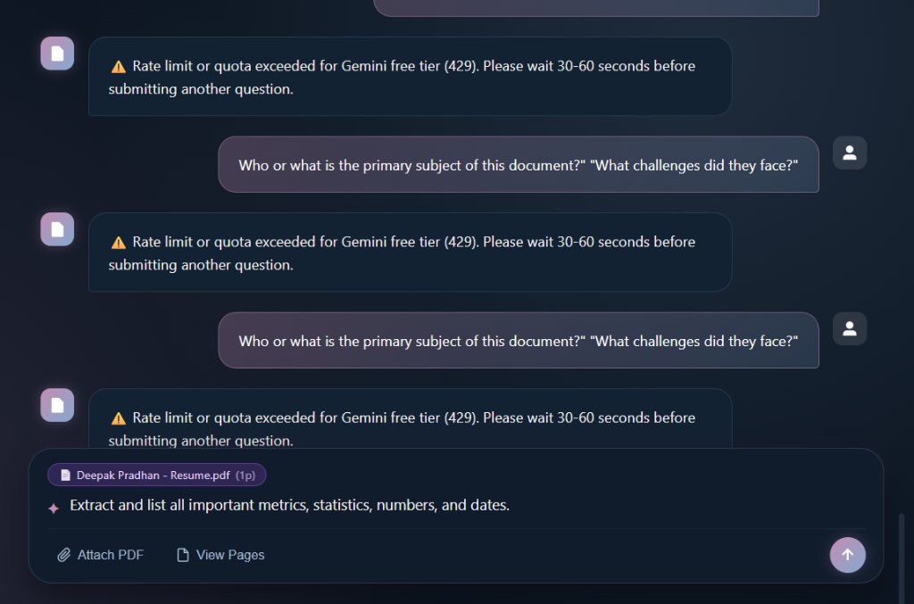

# 📄 docRag — Production-Ready Zero-Budget Document RAG System

[](https://github.com/deepakpradhan1021/docRag/actions)
[](https://www.python.org/)
[](https://fastapi.tiangolo.com/)
[](https://streamlit.io/)
[](https://www.langchain.com/)
[](https://github.com/facebookresearch/faiss)
[](LICENSE)



> **A 100% zero-cost Document Intelligence & Retrieval-Augmented Generation (RAG) platform.**  
> Upload PDFs, cross-reference multiple documents, and receive grounded answers with exact 1-indexed page citations — featuring prompt injection defense, browser-isolated chats, sliding-window rate limiting, and automatic multi-model quota fallback.

---

## 🌟 Live Demo & Links

- **Live Web Application (Netlify + Render 24/7):** [https://docrag-ai.netlify.app](https://docrag-ai.netlify.app)
- **Permanent Cloud Backend (Render):** [https://docrag-3gb4.onrender.com](https://docrag-3gb4.onrender.com)
- **GitHub Repository:** [https://github.com/deepakpradhan1021/docRag](https://github.com/deepakpradhan1021/docRag)

---

## 🔒 Data Privacy & Model Usage Notice

- **Local Embeddings & Vectors:** Embedding generation (`all-MiniLM-L6-v2`) and vector similarity search (FAISS) execute entirely locally on your CPU. Full document vector stores never leave your environment.
- **External LLM Synthesis:** When asking a question, only the top-4 relevant extracted text snippets are sent via HTTPS to Google's Gemini API to generate the synthesis. Note that under Google's standard free-tier API terms of service, prompt data may be used by Google for product enhancement. For sensitive or proprietary enterprise documents, you may specify a paid Google AI Studio / Vertex AI key or switch the LLM provider to a local Ollama model.

---

## 🎨 Professional Dark Aesthetic UI

Inspired by cutting-edge AI product design (**Zyricon** & **Nextmove**), docRag features:
- **Custom Color Palette:** Blended Mauve Orchid (`#C38EB4`), Lilac Blush (`#E1CBD7`), Serene Sky Blue (`#86A8CF`), Slate Ocean (`#26425A`), and Midnight Abyss (`#0B1420`).
- **3D Iridescent Orb:** Smooth floating radial glow sphere serving as the interactive welcome state.
- **Multi-Chat Sidebar:** Create, switch, and delete multiple isolated chat sessions with glowing neon pill indicators.
- **Multi-PDF Document Library:** Attach multiple PDFs to a single chat to compare findings across documents.
- **Document Page Inspector:** Inspect exact extracted text page by page with PyMuPDF.
- **One-Click Export:** Download clean, formatted Markdown Q&A transcripts with source excerpts.

---

## 🏗️ Architectural Flow

```
                      +-----------------------------+
                      |      User Uploads PDF       |
                      +--------------+--------------+
                                     |
                                     v
                      +-----------------------------+
                      |   Validate File & Limits    |
                      | (Size <= 10MB, Pages <= 50) |
                      +--------------+--------------+
                                     |
                                     v
                      +-----------------------------+
                      | Page-by-Page Text Extract   |
                      | (PyMuPDF, 1-Indexed Pages)  |
                      +--------------+--------------+
                                     |
                                     v
                      +-----------------------------+
                      |   Recursive Chunk Splitting |
                      |  (1000 chars, 200 overlap)  |
                      +--------------+--------------+
                                     |
                                     v
                      +-----------------------------+
                      |  Local CPU Embeddings       |
                      |   (all-MiniLM-L6-v2)        |
                      +--------------+--------------+
                                     |
                                     v
                      +-----------------------------+
                      | In-Memory FAISS VectorStore |
                      |    (Session-Isolated)       |
                      +--------------+--------------+
                                     |
    User Question                    v
   +--------------+      +---------------------------+
   |  Chat Input  +----->| Similarity Search (Top-4) |
   +--------------+      +-------------+-------------+
                                       |
                                       v
                         +-----------------------------+
                         | Format Grounded Prompt with |
                         | <untrusted_content> Tags    |
                         +-------------+---------------+
                                       |
                                       v
                         +-----------------------------+
                         | Multi-Model Fallback Engine |
                         | gemini-3.8-flash (Primary)  |
                         | gemini-3.5-flash-lite (1.5k)|
                         +-------------+---------------+
                                       |
                                       v
                         +-----------------------------+
                         | Citation Parser & Validator |
                         | (Maps [Source X] to Pages)  |
                         +-------------+---------------+
                                       |
                                       v
                         +-----------------------------+
                         |  Grounded Answer + Excerpts |
                         +-----------------------------+
```

---

## 🚀 Key Engineering Highlights

1. **Multi-Model Quota Fallback Engine:**
   - Free-tier Google AI Studio keys limit `gemini-3.8-flash` to 20 requests per day.
   - docRag implements an **automatic cascading fallback**:  
     `gemini-3.8-flash` &rarr; `gemini-3.5-flash-lite` (1,500 RPD) &rarr; `gemini-3.5-flash` &rarr; `gemini-2.5-flash-lite` &rarr; `gemini-2.5-flash`.
   - Never gets stranded by a single model's quota exhaustion.

2. **Smart Quota Conservation:**
   - Standalone questions bypass LLM query reformulation, saving 50% of your daily API quota.
   - Only ambiguous follow-up questions with pronouns (*"what did they do next?"*) trigger contextual query clarification.

3. **Strict Source Grounding & Anti-Hallucination:**
   - Answers cite `[Source X]` markers.
   - Code strictly validates citations against actual retrieved chunks and maps them to exact 1-indexed document pages.
   - Rejects hallucinated citations. If information is missing, returns:  
     *"The provided document does not contain enough information to answer this question."*

4. **Prompt Injection Defense:**
   - Document chunks are wrapped in strict `<untrusted_document_content>` XML-style boundary tags.
   - System prompt instructs the model to treat content as passive untrusted data, preventing adversarial override instructions.

5. **100% Zero Budget Stack:**
   - No paid vector databases (In-memory FAISS).
   - No paid embedding APIs (Local CPU Sentence-Transformers `all-MiniLM-L6-v2`).
   - Free LLM tier with fallback support.

---

## 💰 Zero-Budget Stack Comparison

| Component | Technology | Cost | Why Chosen |
|---|---|---|---|
| **Language** | Python 3.10 - 3.13 | $0 | Clean syntax, rich ecosystem, standard for AI engineering |
| **Backend API** | FastAPI + Uvicorn | $0 | High-performance asynchronous REST API with auto OpenAPI docs |
| **Frontend UI** | HTML5 / CSS3 / Vanilla JS | $0 | Fast, zero build step, dark aesthetic, interview-ready |
| **Alternative UI** | Streamlit | $0 | Quick Python-only prototyping interface |
| **PDF Extraction** | PyMuPDF (`pymupdf`) | $0 | 10x faster than PyPDF, accurate page boundary tracking |
| **Embeddings** | Sentence-Transformers (`all-MiniLM-L6-v2`) | $0 | Compact (~80MB), runs on CPU in milliseconds |
| **Vector Store** | In-Memory FAISS (`faiss-cpu`) | $0 | Zero infra overhead, instantaneous similarity search, isolated per session |
| **LLM Inference** | Google Gemini (`gemini-3.8-flash` / `3.5-flash-lite`) | $0 | Free tier via Google AI Studio |
| **Static Hosting** | Netlify (`netlify.toml`) | $0 | Instant worldwide CDN deployment for `static/` |

---

## 📁 Project Structure

```text
docRag/
├── server.py                       # FastAPI REST API & static asset server
├── app.py                          # Streamlit application (alternative UI)
├── netlify.toml                    # Netlify deployment & SPA routing config
├── requirements.txt                # Pinned production dependencies
├── .env.example                    # Local environment variables template
├── .gitignore                      # Git exclusion rules
├── static/                         # Custom Dark Web Interface
│   ├── index.html                  # Responsive layout & Zyricon/Nextmove UI
│   ├── style.css                   # Custom color palette & 3D floating orb styles
│   └── app.js                      # Multi-chat, drag-drop upload, export, fallback logic
├── src/
│   ├── __init__.py                 # Package initializer
│   ├── config.py                   # Centralized configuration, models, & limits
│   ├── chat_manager.py             # Multi-chat & multi-document state manager
│   ├── pdf_processing.py           # PyMuPDF extraction, validation, & limits
│   ├── vector_store.py             # Chunking, local embeddings, & FAISS indexing
│   └── rag_pipeline.py             # Grounded prompting, model fallback cascade, citations
└── tests/
    ├── __init__.py
    ├── test_pdf_processing.py      # PDF parsing and validation tests
    ├── test_vector_store.py        # Chunking & FAISS retrieval tests
    ├── test_rag_pipeline.py        # Prompt grounding & citation validation tests
    ├── test_session_and_e2e.py     # Multi-document session & reset tests
    └── test_api_server.py          # FastAPI REST endpoint integration tests
```

---

## ⚙️ Key Configuration Settings

All settings are centralized in [`src/config.py`](src/config.py):

| Setting | Default | Rationale & Trade-off |
|---|---|---|
| `MAX_FILE_SIZE_MB` | `10 MB` | Prevents high memory consumption on free hosts. |
| `MAX_PAGES` | `50 pages` | Ensures local CPU embedding generation stays under ~20 seconds. |
| `CHUNK_SIZE` | `1000 chars` (~200 words) | Balances specific sentence retrieval with sufficient surrounding context. |
| `CHUNK_OVERLAP` | `200 chars` (20%) | Prevents critical facts from being split across chunk boundaries. |
| `RETRIEVAL_TOP_K` | `4 passages` | Supplies ~4,000 characters of evidence — compact, fast, and quota-friendly. |
| `LLM_TEMPERATURE` | `0.1` | Near-zero temperature minimizes creative hallucinations. |
| `CANDIDATE_MODELS` | `3.8-flash, 3.5-flash-lite, 3.5-flash` | Auto-cascading model list for zero downtime. |

---

## 🛠️ Quickstart & Local Setup

### 1. Clone the repository
```bash
git clone https://github.com/deepakpradhan1021/docRag.git
cd docRag
```

### 2. Create and activate a virtual environment
**Windows (PowerShell):**
```powershell
python -m venv venv
.\venv\Scripts\Activate.ps1
```

**macOS / Linux:**
```bash
python3 -m venv venv
source venv/bin/activate
```

### 3. Install dependencies
```bash
pip install -r requirements.txt
```

### 4. Configure your free Gemini API key
```bash
cp .env.example .env
```
Edit `.env` (or enter your key directly in the web UI Settings modal):
```ini
GOOGLE_API_KEY=AIzaSyYourActualKeyHere
```
*(Get a free key from [Google AI Studio](https://aistudio.google.com/apikey) in 10 seconds)*.

### 5. Run the Application

#### Option A: Custom Dark Web Interface (FastAPI + Modern UI) — Recommended
```bash
python server.py
```
Open **`http://127.0.0.1:8000`** in your browser.

#### Option B: Docker Container (One-Command Deployment)
```bash
docker compose up --build
```
Open **`http://localhost:8000`** in your browser.

#### Option C: Classic Streamlit Interface
```bash
streamlit run app.py
```
Open **`http://localhost:8501`** in your browser.

---

## 📊 ML Retrieval & Page Hit Benchmark

docRag includes an empirical evaluation harness (`eval_benchmark.py`) that tests retrieval accuracy against a synthetic 10-page ground-truth document using the exact production chunking parameters (1000 chunk size, 200 overlap):

```bash
python eval_benchmark.py
```

### Benchmark Results:
```text
=================================================================
      docRag Retrieval Precision & Page Hit Benchmark
=================================================================
Q01: Expected Page 01 | Top-1: Page 1  | Hits: [1]       -> [PASS (Top-1)]
Q02: Expected Page 02 | Top-1: Page 8  | Hits: [8, 2, 5] -> [PASS (Recall@3)]
Q03: Expected Page 03 | Top-1: Page 3  | Hits: [3, 8, 6] -> [PASS (Top-1)]
Q04: Expected Page 04 | Top-1: Page 4  | Hits: [4, 6]    -> [PASS (Top-1)]
Q05: Expected Page 05 | Top-1: Page 5  | Hits: [5, 3, 1] -> [PASS (Top-1)]
Q06: Expected Page 06 | Top-1: Page 6  | Hits: [6, 3, 2] -> [PASS (Top-1)]
Q07: Expected Page 07 | Top-1: Page 7  | Hits: [7, 9, 6] -> [PASS (Top-1)]
Q08: Expected Page 08 | Top-1: Page 8  | Hits: [8, 6, 5] -> [PASS (Top-1)]
Q09: Expected Page 09 | Top-1: Page 9  | Hits: [9, 3, 1] -> [PASS (Top-1)]
Q10: Expected Page 10 | Top-1: Page 10 | Hits: [10, 1, 5]-> [PASS (Top-1)]
-----------------------------------------------------------------
Top-1 Precision: 9/10 (90.0%)
Recall@3 (Passage Hit Rate): 10/10 (100.0%)
=================================================================
```

---

## 🧪 Automated Test Suite

docRag includes 24 unit and API integration tests covering:
- Correct 1-indexed page extraction and empty/scanned PDF detection.
- Chunk splitting and FAISS CPU vector similarity search.
- Prompt injection boundary defense.
- Valid citation mapping (`[Source X]` to document name, page, and excerpt).
- Rejection of hallucinated citations.
- Missing API key and rate-limit error handling.
- FastAPI REST endpoints (`/api/chats`, `/api/chats/{id}/upload`, `/api/chats/{id}/message`, `/api/chats/{id}/export`, `/api/health`).

Run all tests:
```bash
python -m unittest discover tests -v
```

Expected result:
```text
Ran 24 tests in 20.1s

OK
```

---

## 🚀 Permanent Cloud Deployment (Render & Hugging Face)

docRag can be deployed permanently to the cloud for free with zero sleep timeouts:

### Deploying on Render (Free Web Service):
1. Create a free account at [render.com](https://render.com).
2. Click **New +** &rarr; **Web Service** &rarr; Connect your GitHub repo `deepakpradhan1021/docRag`.
3. Choose **Docker** as runtime environment.
4. Set environment variable: `GOOGLE_API_KEY` (or let users supply their own in the UI Settings modal).
5. Deploy! Render builds the included `Dockerfile` and gives you a permanent HTTPS URL like `https://docrag.onrender.com`.

---

## 📜 License

MIT License &copy; 2026 Deepak Pradhan. Free for personal, academic, and commercial use.
