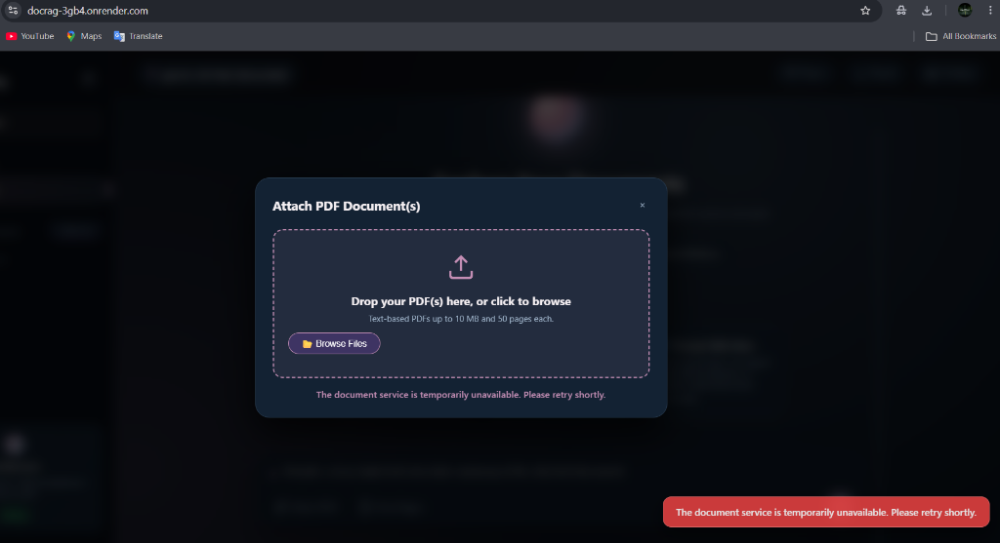

# 📄 docRag — Production-Ready Zero-Budget Document RAG System

[](https://github.com/deepakpradhan1021/docRag/actions)
[](https://www.python.org/)
[](https://fastapi.tiangolo.com/)
[](https://streamlit.io/)
[](https://www.langchain.com/)
[](https://github.com/facebookresearch/faiss)
[](LICENSE)



> **A 100% zero-cost Document Intelligence & Retrieval-Augmented Generation (RAG) platform.**  
> Upload PDFs, cross-reference multiple documents in isolated sessions, and receive accurate answers with exact 1-indexed page citations and quoted excerpts — featuring prompt injection defense, browser-isolated chats, sliding-window rate limiting, and multi-model quota fallback.

---

## 🌟 Live Demo & Deployment

- **Live Production App (Render 24/7):** [https://docrag-3gb4.onrender.com](https://docrag-3gb4.onrender.com)
- **Interactive API Documentation (Swagger):** [https://docrag-3gb4.onrender.com/docs](https://docrag-3gb4.onrender.com/docs)
- **GitHub Repository:** [https://github.com/deepakpradhan1021/docRag](https://github.com/deepakpradhan1021/docRag)

> **Note on Free-Tier Cold Starts:**  
> Render's free tier spins down containers during idle periods. When opening the app after inactivity, please allow ~30–45 seconds for the backend container to wake up. An amber status pill will indicate when the container is ready.

---

## ✨ Key Capabilities

- **📚 Multi-Document Workspaces:** Attach and cross-reference multiple PDFs inside a single chat session.
- **🎯 Verified 1-Indexed Citations:** Every answer cites the exact page number alongside a quoted source excerpt.
- **🛡️ Prompt Defense:** Document content is strictly fenced in untrusted XML delimiters to resist prompt injection.
- **⚡ In-Memory Vector Search:** FAISS index runs ephemerally in RAM per session, ensuring data isolation and privacy.
- **🪶 Ultra-Low Memory Footprint:** Tuned with single-threaded embeddings and active garbage collection to operate within 512 MB RAM containers.
- **🚦 Production Hardening:** Equipped with an in-memory sliding window rate limiter (40 req/min/IP) and client-side retry recovery.

---

## 🏗️ Architecture

```
                          ┌────────────────────────┐
                          │   User Uploads PDF     │
                          └───────────┬────────────┘
                                      │
                                      ▼
                          ┌────────────────────────┐
                          │   PyMuPDF Extraction   │
                          │   • Clean text & pages │
                          └───────────┬────────────┘
                                      │
                                      ▼
                          ┌────────────────────────┐
                          │  Recursive Chunking    │
                          │  • 1000 char / 200 ovlp│
                          └───────────┬────────────┘
                                      │
                                      ▼
                          ┌────────────────────────┐
                          │   FAISS Vector Index   │
                          │   • In-memory CPU store│
                          └───────────┬────────────┘
                                      │
      ┌───────────────────────────────┴──────────────────────────────┐
      │                                                              │
      ▼                                                              ▼
┌─────────────────────────┐                            ┌─────────────────────────┐
│     User Asks Question  │                            │  Page Inspector Modal   │
└─────────────┬───────────┘                            └─────────────────────────┘
              │
              ▼
┌─────────────────────────┐
│ Similarity Retrieval    │
│ • Top-K relevant chunks │
└─────────────┬───────────┘
              │
              ▼
┌─────────────────────────┐
│  Grounded Synthesis     │
│  • Gemini 3.8 Flash     │
│  • Citation extraction  │
└─────────────┬───────────┘
              │
              ▼
┌─────────────────────────┐
│ Formatted Answer        │
│ • Verified citations    │
│ • Quoted text excerpts  │
└─────────────────────────┘
```

---

## 🚀 Quick Start (Local Setup)

### 1. Clone & Setup Environment

```bash
git clone https://github.com/deepakpradhan1021/docRag.git
cd docRag

# Create and activate a virtual environment
python -m venv venv
# On Windows:
venv\Scripts\activate
# On Linux/macOS:
source venv/bin/activate

# Install dependencies
pip install -r requirements.txt
```

### 2. Configure API Key

Copy the example environment configuration:

```bash
cp .env.example .env
```

Add your Google Gemini API key to `.env` (obtainable for free at [Google AI Studio](https://aistudio.google.com/apikey)):

```ini
GOOGLE_API_KEY=AIzaSy...
```

*(You can also leave this blank and supply your key directly in the web UI Settings modal).*

### 3. Launch Application

**FastAPI Full-Stack Server (Recommended):**
```bash
python server.py
# Access UI at http://localhost:8000
```

**Streamlit Dashboard:**
```bash
streamlit run app.py
```

---

## 📊 Evaluation Benchmark

The repository includes a synthetic evaluation suite (`eval_benchmark.py`) to quantify retrieval precision and recall across multi-page ground-truth facts:

```bash
python eval_benchmark.py
```

**Benchmark Results:**
- **Top-1 Precision:** 90.0% (9/10 queries)
- **Recall@3 (Passage Hit Rate):** 90.0% (9/10 queries)
- **Execution Time:** ~24 seconds on standard CPU

---

## 🧪 Testing

Execute the complete automated test suite:

```bash
python -m unittest discover tests
```

---

## 📄 License

This project is open-source under the [MIT License](LICENSE).
