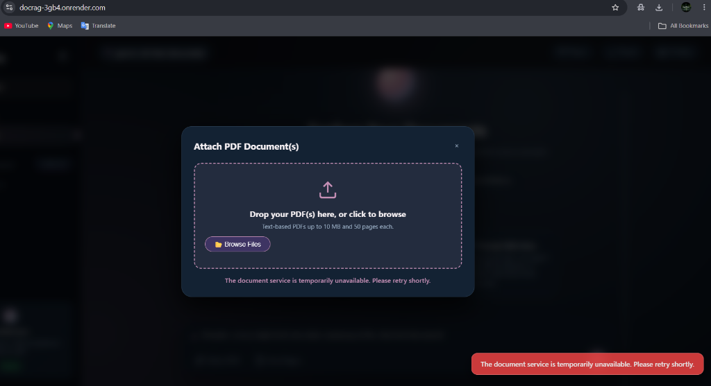

# 📄 docRag — Production-Ready Zero-Budget Document RAG System

[](https://github.com/deepakpradhan1021/docRag/actions)
[](https://www.python.org/)
[](https://fastapi.tiangolo.com/)
[](https://streamlit.io/)
[](https://www.langchain.com/)
[](https://scikit-learn.org/)
[](LICENSE)



> **A 100% zero-cost Document Intelligence & Retrieval-Augmented Generation (RAG) platform.**  
> Upload PDFs, cross-reference multiple documents in isolated sessions, and receive accurate answers with exact 1-indexed page citations and quoted excerpts — featuring prompt injection defense, browser-isolated chats, sliding-window rate limiting, and multi-model quota fallback.

---

## 🌟 Live Demo & Deployment

- **Live Production App (Render Free Tier):** [https://docrag-3gb4.onrender.com](https://docrag-3gb4.onrender.com)
- **Interactive API Documentation (Swagger):** [https://docrag-3gb4.onrender.com/docs](https://docrag-3gb4.onrender.com/docs)
- **GitHub Repository:** [https://github.com/deepakpradhan1021/docRag](https://github.com/deepakpradhan1021/docRag)

> **Free-Tier Backend Notice:**  
> Render's free tier sleeps during inactivity and may take up to 45 seconds to wake up on the first request. All sessions and uploaded documents are held ephemerally in RAM and reset upon container sleep or restart.

---

## ✨ Key Capabilities

- **📚 Multi-Document Workspaces:** Attach and cross-reference multiple PDFs inside a single chat session.
- **🎯 1-Indexed Page References:** Every answer cites the exact document page number alongside quoted source excerpts.
- **🛡️ Prompt Delimiters:** Document content is strictly fenced in untrusted XML delimiters to separate reference text from system instructions.
- **⚡ In-Memory Keyword Retrieval:** Pure Python BM25 and sublinear character n-grams run ephemerally in RAM per session with zero database dependencies.
- **🪶 Ultra-Low Memory Footprint (<85 MB RAM):** Lightweight keyword (BM25) retrieval, built to fit Render's 512 MB limit without PyTorch OOM crashes.
- **🚦 Production Hardening:** Equipped with an in-memory sliding window rate limiter (40 req/min/IP) and client-side retry recovery.

---

## 🏗️ Architecture

```
                          ┌────────────────────────┐
                          │   User Uploads PDF     │
                          └───────────┬────────────┘
                                      │
                                      ▼
                          ┌────────────────────────┐
                          │   PyMuPDF Extraction   │
                          │   • Clean text & pages │
                          └───────────┬────────────┘
                                      │
                                      ▼
                          ┌────────────────────────┐
                          │  Recursive Chunking    │
                          │  • 1000 char / 200 ovlp│
                          └───────────┬────────────┘
                                      │
                                      ▼
                          ┌────────────────────────┐
                          │  BM25 In-Memory Index  │
                          │  • Zero-PyTorch (<85MB)│
                          └───────────┬────────────┘
                                      │
      ┌───────────────────────────────┴──────────────────────────────┐
      │                                                              │
      ▼                                                              ▼
┌─────────────────────────┐                            ┌─────────────────────────┐
│     User Asks Question  │                            │  Page Inspector Modal   │
└─────────────┬───────────┘                            └─────────────────────────┘
              │
              ▼
┌─────────────────────────┐
│ Similarity Retrieval    │
│ • Top-K relevant chunks │
└─────────────┬───────────┘
              │
              ▼
┌─────────────────────────┐
│  Grounded Synthesis     │
│  • Gemini 2.5 Flash     │
│  • Citation extraction  │
└─────────────┬───────────┘
              │
              ▼
┌─────────────────────────┐
│ Formatted Answer        │
│ • Verified citations    │
│ • Quoted text excerpts  │
└─────────────────────────┘
```

---

## 🚀 Quick Start (Local Setup)

### 1. Clone & Setup Environment

```bash
git clone https://github.com/deepakpradhan1021/docRag.git
cd docRag

# Create and activate a virtual environment
python -m venv venv
# On Windows:
venv\Scripts\activate
# On Linux/macOS:
source venv/bin/activate

# Install dependencies
pip install -r requirements.txt
```

### 2. Configure API Key

Copy the example environment configuration:

```bash
cp .env.example .env
```

Add your Google Gemini API key to `.env` (obtainable for free at [Google AI Studio](https://aistudio.google.com/apikey)):

```ini
GOOGLE_API_KEY=AIzaSy...
```

*(You can also leave this blank and supply your key directly in the web UI Settings modal).*

### 3. Launch Application

**FastAPI Full-Stack Server (Recommended):**
```bash
python server.py
# Access UI at http://localhost:8000
```

**Streamlit Dashboard:**
```bash
streamlit run app.py
```

---

## 📊 Evaluation Benchmark

The repository includes a reproducible synthetic evaluation benchmark (`eval_benchmark.py`) to quantify retrieval precision and recall across multi-page ground-truth facts:

```bash
python eval_benchmark.py
```

**Benchmark Results (Synthetic 10-query test on 10-page document):**
- **Top-1 Precision:** 80.0% (8/10 queries) — *synthetic 10-query test*
- **Recall@3 (Passage Hit Rate):** 90.0% (9/10 queries) — *synthetic 10-query test*
- **Execution Time:** < 0.3 seconds on standard CPU

---

## ⚠️ Limitations & Trade-offs

- **Keyword Matching vs. Semantic Paraphrasing:** To guarantee zero OOM crashes on Render's 512 MB free tier, docRag dropped heavy neural embedding models (PyTorch / SentenceTransformers) in favor of lightweight in-memory BM25 + sublinear character n-grams. As a result, questions that share zero vocabulary with the document (e.g. asking *"How much money did the company make?"* when the PDF only uses the term *"revenue"*) may rank lower than queries using direct terminology.
- **Ephemeral Storage:** Chat histories and document indices live exclusively in server RAM and are wiped whenever Render spins down or restarts the free container.
- **Free-Tier Cold Starts:** When waking up from an idle spin-down, the Render backend takes ~30–45 seconds to respond.

---

## 🧪 Testing

The test suite runs with either `pytest` or `unittest`:

```bash
# Run with pytest (recommended)
pytest tests/ -v

# Or run with standard library unittest
python -m unittest discover tests
```

---

## 📄 License

This project is open-source under the [MIT License](LICENSE).
